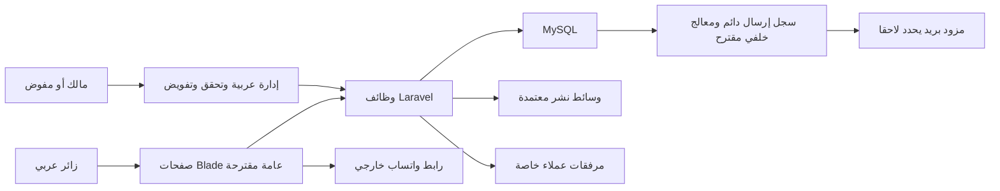

# التقييم المعماري لمشروع Scenery

توصية أولية للمراجعة، لا تطبيق أو قرار شراء. المصادر S1 §10.1 وS2 §§5،13–17، وتعريفهما في [المراجعة](SRS_REVIEW.md). تبقى النسخ والمكتبات والخدمات والتشغيل خاضعة لـQ-B وQ-L في [القرارات](OPEN_QUESTIONS.md).

## ما اعتمد وما يقترح

| المستوى | الموقف |
|---|---|
| مؤكد | HTML5 وCSS3 وJavaScript ES6+؛ PHP/Laravel؛ MySQL؛ عربية وRTL؛ موقع عرض واستفسارات |
| توجيه SRS للتنفيذ اللاحق | Eloquent وMigrations عند تصميم وتنفيذ البيانات؛ Mail/Queue لإرسال التنبيهات بعد حفظها |
| موصى به غير مقفل | Laravel MVC كتطبيق واحد، Blade مولد من الخادم، Vite لبناء الأصول، تفويض Policies/Gates، Form Requests وFilesystem |
| قرار مفتوح | النسخ المدعومة، CSS وJS الاختياريان، وسيط الطابور وآلية تحديث الإشعارات، الاستضافة ومعالجة الفيديو والتخزين |
| غير مسموح دون تغيير صريح | React/Next.js/Vue/Angular أو SPA، TypeScript إلزامية، Backend أو قاعدة بيانات بديلة، تكامل واتساب رسمي أو تخزين خارجي غير معتمد |

الترجيح هو **تطبيق واحد منظم حسب الوظائف** يخدم الموقع والإدارة، بدل خدمات موزعة أو API عامة منفصلة. Blade مناسب لعرض المحتوى العربي وSEO والتفاعلات المحدودة. لا يعني منع SPA منع طلب Fetch صغير لاحقًا؛ أي استجابة بيانات تخضع لنفس التحقق والتفويض. Eloquent لا يفرض مستودع Repository لكل كيان أو تعقيدًا متعدد الطبقات دون حاجة.

## فصل المسؤوليات وتنظيم Laravel المقترح

| الجزء المقترح | المسؤولية | الحدود |
|---|---|---|
| العرض عبر Blade | صفحات عامة ومكونات تنقل ونماذج وإدارة عربية؛ Escaping افتراضي | لا استعلامات أو منطق صلاحيات حساس داخل القالب |
| Controllers مستقبلية | استقبال الطلب والتنسيق وإرجاع الاستجابة | لا تجمع معالجة فيديو أو إرسال بريد متزامن داخل طلب المستخدم |
| Form Requests | التحقق والأخطاء العربية، ثم التفويض عند الحاجة | لا ثقة بالمعرف أو نوع الملف أو نصوص الزائر |
| Actions/Services عند الحاجة | حفظ استفسار متسق، نشر الرئيسية، ربط الوسائط | حدود المعاملة واضحة؛ تستخدم حيث يوجد سير عمل حقيقي |
| Models/Eloquent | العلاقات وقواعد الوصول للمنشور واستعلامات محددة | المصدر العام لا يسترجع أسعارًا مخفية أو بيانات العملاء |
| Policies/Gates | فحص القدرة والفعل والكائن والتنزيل | يطبق على كل طلب؛ لا يعتمد على قائمة جانبية مخفية |
| Jobs/Notifications/Mail | معالجة وسائط وإرسال ومتابعة المحاولات | قابلة للإعادة، لا تحمل مرفقات خاصة داخل رسالة البريد |
| Filesystem | فصل عام/خاص، أسماء ملفات داخلية، مشتقات وأغلفة | لا ربط ملفات العملاء بمكتبة النشر العامة |
| CSS/JS وأصول البناء | ملفات حسب المكونات والوظائف، نقطة تحميل صغيرة لكل سياق | لا تحميل مكتبة المعرض والفيديو في صفحات لا تستخدمها |

هذه أسماء مسؤوليات وأجزاء محتملة وليست ملفات أو Controllers أو Routes تم إنشاؤها. لا نسخ محددة مفروضة قبل Q-B01، ولا Redis أو WebSockets أو حزمة صلاحيات إضافية معتمدة افتراضيًا.

الرسم يوضح حدودًا مفاهيمية داخل التطبيق؛ الصناديق لا تعني خدمات مستقلة أو اختيار مزود خارجي. تفاصيل الكيانات في [النموذج](CONCEPTUAL_DATA_MODEL.md).

## مسار حفظ الاستفسار والتنبيه

المؤكد: صحة المدخلات، حفظ الطلب، ظهور تنبيه إداري، إرسال لاحق ومتابعة فشله (LEAD-001، ALERT-001–004، BR-03). التوصية التقنية:

1. يصدر نموذج الطلب مرجع إرسال لاستخدامه مرة واحدة. يتحقق الخادم من السياق وصلاحية المنتج/المشروع والموافقة وحقول التواصل. سياسة مدة الاحتفاظ بالمفتاح تحتاج Q-B16.
2. المرفق، عند اعتماده، يرفع إلى مساحة مؤقتة خاصة ويُفحص قبل اعتماده. ينسق حفظ مرجعه مع المعاملة؛ لا يدعي النظام أن MySQL تستطيع التراجع آليًا عن كتابة ملف. تعالج الملفات اليتيمة بتنظيف آمن بعد مهلة معتمدة.
3. تحفظ معاملة واحدة الاستفسار والتنبيه الإداري و**سجل نية إرسال دائم**. هذا السجل توصية لتمثيل EmailJob الوارد مفاهيميًا بالمصدر، لا نظام رسائل مستقل.
4. لا تظهر رسالة النجاح إلا بعد نجاح الحفظ. يعاد نفس المرجع للضغط المكرر؛ لا يصدر إشعار جديد لنفس الإرسال.
5. عامل أو مهمة مجدولة يلتقط سجلات الإرسال المنتظرة ويمررها إلى Mail/Queue. عند استخدام Queue مرتبط بمعاملات، تراعى آلية `after_commit` كي لا يعمل قبل اكتمال الحفظ. هذه الآلية وحدها لا تعالج انقطاع العملية بين Commit وDispatch؛ يعالج سجل الإرسال والمصالحة تلك الفجوة. دعم Laravel لانتظار المعاملات موثق في [الطوابير](https://laravel.com/framework/docs/queues#jobs-and-database-transactions)؛ قرار السجل الدائم استنتاج هندسي لهذا المشروع.
6. تحفظ حالة محاولة الإرسال وإعادة المحاولة والتعثر؛ تراقب توقف العامل وتراكم الرسائل، وتتوفر معالجة مخولة للمهام الفاشلة. آلية التشغيل والمهلة والتصعيد قرارات Q-B11/12.

قبول المزود للرسالة ليس إثبات وصولها إلى Inbox. لا وعد بتسليم Exactly-once؛ يحد مفتاح ارتباط وحالة إرسال من التكرار، مع بقاء حالة انقطاع اتصال المزود غامضة تحتاج مراجعة. قبل كل محاولة يتحقق أن المستلم ما زال معتمدًا، وتعلّق الرسائل الموجهة إلى عنوان سُحبت صلاحيته. البريد يحمل ملخصًا محدودًا ورابط إدارة يتطلب الدخول.

## المكتبات ومفاضلة الواجهة

كل صف **توصية أو خيار**، لا تثبيت معتمد. تكلفة الأداء تقدير نوعي؛ تقاس الحزمة والتحميل والحركة لاحقًا بالمحتوى الفعلي. لا تجمع Tailwind وBootstrap.

| الخيار | الوظيفة والسبب | أثر الأداء | التكامل والصيانة | البديل والترجيح |
|---|---|---|---|---|
| CSS مخصص منظم | هوية خاصة ومساحات ومكونات محدودة دون مكتبة شكلية مفروضة | أصغر اعتماد خارجي؛ يتطلب ضبط تكرار القواعد | يعمل مع Blade وVite؛ يحتاج رموز تصميم وتوثيق مكونات | أساس مناسب؛ قارن مع Tailwind عند تقدير حجم الإدارة |
| Tailwind CSS | Utility classes لبناء هوية مخصصة ومكونات متسقة | بناء CSS مخصص للاستخدام؛ يجب فحص مخرجات البناء وعدم تكوين أسماء غير مرئية للأداة | متوافق مع قوالب Blade؛ يحتاج اتفاق فريق على تنظيم الأصناف ودعم المتصفحات | مرشح إذا اعتمد Q-B02؛ [توثيق الحالات وRTL](https://tailwindcss.com/docs/hover-focus-and-other-states) |
| Bootstrap | شبكة ومكونات ونماذج جاهزة مع إصدار RTL | قد يحمل CSS/JS أكثر من الحاجة إن أخذ كاملًا | سهل لفريق متمرس؛ تخصيص ضروري لتجنب قالب عام؛ [RTL الرسمي](https://getbootstrap.com/docs/5.3/getting-started/rtl/) | بديل لـTailwind/CSS المخصص وليس إضافة تؤدي الوظيفة نفسها |
| Vanilla JavaScript | تفاعل قائمة ونموذج ومعرض بسيط حسب الحاجة | أقل Runtime، مع تحميل انتقائي | متوافق مباشرة؛ تنظيم وحدات وتهيئة واضحة عبر Vite | الترجيح الابتدائي؛ لا إطار JS إلزامي |
| Alpine.js | حالات محلية متكررة إن صارت Vanilla مرهقة | Runtime إضافي صغير نسبيًا يحتاج قياسًا | يلائم HTML/Blade؛ يضاف فقط عند حاجة موثقة | Vanilla يكفي أولًا؛ النسخة والتوافق تفحص عند القرار |
| Swiper | معرض أو تنقل وسائط إذا لزم تحكم باللمس | JS/CSS إضافيان؛ لا يحمل في كل الصفحات | يحتاج اختبار RTL والكيبورد والتركيز؛ لا Autoplay مفترض | CSS/native gallery أو مكون صغير؛ يقيّم فقط بعد UX |
| GSAP | حركة مخصصة ذات غرض واضح يصعب تنفيذها بـCSS | تكلفة إضافية وتحتاج ميزانية حركة | استخدام جزئي، اختبار تقليل الحركة؛ ليس مطلبًا تجاريًا | CSS transitions أساس كافٍ؛ لا يضاف لمجرد الزخرفة |

Laravel يوفّر تكامل Vite لبناء الأصول؛ لا يفرض ذلك مكتبة واجهة بعينها. [التوثيق الرسمي](https://laravel.com/framework/docs/vite). لا تختار نسخ Alpine/Swiper/GSAP أو تصفها معتمدة دون فحص وثائقها الحالية عند Q-B02.

## الوسائط والفيديو

تفصل ملفات العرض التي اعتمد نشرها عن مرفقات الاستفسار. التخزين المحلي خيار دراسة، وليس افتراض أن الاستضافة تكفي لكل الفيديوهات. لا تخزين سحابي أو منصة فيديو أو CDN دون موافقة. يوفر Laravel Filesystem فصل `public/private` وإمكان الوصول المؤقت وفق إعداد مناسب؛ [مرجع التخزين](https://laravel.com/framework/docs/13.x/filesystem). الرابط المؤقت لا يغني عن تحقق التفويض حين يطلب الملف الخاص.

تفحص هوية الرافع وحجمه وعدده وصيغته وتوقيعه الفعلي، لا الامتداد فقط. أسماء داخلية غير قابلة للتنفيذ ومنع SVG/HTML النشط أو وضع سياسة تنظيف مستقلة إن احتاج المشروع أنواعًا خاصة. تدرس إزالة بيانات EXIF الحساسة ومعالجة الصور في مشتقات ووقف النشر حتى تصبح المادة جاهزة. قواعد Laravel تدعم التحقق من أنواع وأحجام الملفات؛ لا تثبت وحدها خلو المحتوى من الضرر. [مرجع التحقق](https://laravel.com/framework/docs/validation#validating-files).

تحميل كسول لما تحت الطية، وتحديد أبعاد الصور ومقاسات مناسبة وصيغ محسنة. لا يجعل ملف Hero الرئيسي كسولًا تلقائيًا إذا كان عنصر التحميل الأهم. فيديو Hero صامت حيث يسمح المتصفح، مع غلاف متاح قبل التحميل وتقليل حركة ومسار فشل واضح. فيديو المشروع يبدأ بطلب المستخدم وضوابط تشغيل؛ ضغطه/تحويله أو خادم بثه يحتاج قياس القدرات وQ-B10. الربط المرجعي يعيد استخدام الملف؛ المشتقات ليست نسخ محتوى يرفعها المالك يدويًا. يمنع حذف الملف المستخدم في مسودة أو منشور قبل فك ارتباطه وفق السياسة.

## الأمان والخصوصية

مصادقة جلسة للإدارة، HTTPS وCookies مناسبة، حماية CSRF والتحقق من كل المدخلات وEscaping ومنع Mass Assignment غير المقصود. صلاحيات فعل وكائن للرفع والتنزيل والبيانات، وإبطال الوصول فور تعطيل المستخدم أو سحب حقه. يدعم Laravel Policies/Gates هذا الفصل؛ [مرجع التفويض](https://laravel.com/framework/docs/authorization).

المرفقات لا تدخل Public disk أو Sitemap أو البريد كمرفق مفتوح. لا بيانات شخصية في عنوان URL أو Metadata أو Cache عام أو سجلات تفصيلية. البريد والإعدادات والأسرار خارج الكود، وبيئة التطوير لا تحتاج نسخة عملاء حقيقية. تحدد سياسة الاحتفاظ والحذف بالتنسيق مع المالك ومراجعه القانوني، ولا يدعي هذا التحليل تحقق امتثال قانوني.

## الأداء وSEO وRTL

صفحات قابلة للفهرسة من الخادم، روابط مستقرة ومحتوى عربي حقيقي وعناوين ووصف وSitemap للمحتوى المنشور فقط. تحرير Metadata من الإدارة ميزة CMS-009 المقترحة، بينما وجود أساس SEO متطلب غير وظيفي. لا بيانات سعر مخفي في HTML أو JSON-LD أو بيانات المشاركة أو رد عام، وتبطل النسخ المخبأة عند تغيير النشر أو السعر. فهارس واستعلامات محددة وPagination وتجنب N+1؛ تحدد الفهارس بعد أحجام واستعلامات واقعية.

تستخدم خصائص CSS المنطقية، واتجاه مناسب للنص العربي والروابط والأكواد، وأرقام هاتف دولية دون قلب ترتيبها. لا يفترض أن قلب الصفحة يعكس أيقونة كل سهم أو أداة فيديو بصورة صحيحة. تختبر حالات RTL يدويًا وعلى الهاتف، وتتوفر تسميات وتركيز ورسائل خطأ واضحة وتقليل حركة.

أهداف مبدئية **غير معتمدة كـSLA**: LCP حتى 2.5 ثانية، INP حتى 200 مللي ثانية، CLS حتى 0.1 عند تقييم زيارات فعلية مناسبة؛ الاختبار المعملي لا يثبت نجاح جمهور المستخدمين. مصادر التعريف والأهداف: [Google Core Web Vitals](https://developers.google.com/search/docs/appearance/core-web-vitals). اعتماد الأجهزة والشبكات والميزانية وهدف الوصول في Q-L07. لا وعد بترتيب بحث أو نسبة تحويل.

## التشغيل والتوسع

تراجع الاستضافة مبكرًا لدعم نسخة PHP/MySQL وبناء الأصول وWorkers/Scheduler وأحجام HTTP/PHP والتخزين. قاعدة البيانات والوسائط وخرائط الربط تدخل النسخ الاحتياطي مع اختبار استعادة متسق وRPO/RTO معتمدين، وسجلات أخطاء خالية من الأسرار وتنبيه مسؤول الأعطال.

يبقى Inquiry سجل اهتمام وليس Order. يحفظ Product هويته ووضع السعر دون مخزون أو حجز أو دفع. عند اعتماد متجر مستقبلًا تجمع متطلباته من جديد وتضاف كياناته وخدماته لاحقًا؛ لا تنشأ جداول تجارة أو Microservices استباقية الآن.

## شروط اعتماد التوصية

اعتماد Q-B01–Q-B16 حسب الوظيفة، وإقرار قرار التخزين والمستلم والعمال، ومواءمة [النموذج المفاهيمي](CONCEPTUAL_DATA_MODEL.md) مع [المخاطر](RISK_ASSESSMENT.md). الروابط التقنية أعلاه توثيق وقت المراجعة، ولا تعني اعتماد إصدار Laravel المعروض بها. لم تكتب ملفات تشغيل أو أوامر تثبيت أو كود تطبيق.
