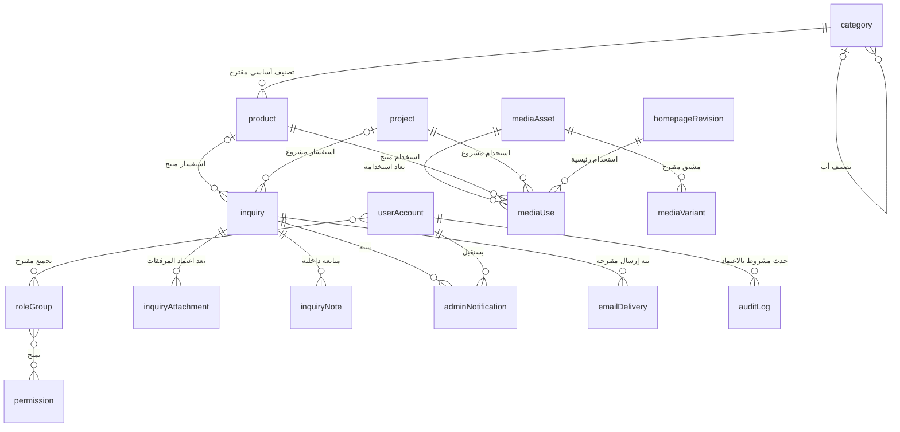

# النموذج المفاهيمي لبيانات Scenery

المرجع S1 §§8،10.1،11 وS2 §17، وتعريف المصادر في [المراجعة](SRS_REVIEW.md). النموذج تفسير مبدئي للمراجعة، **ليس SQL أو مخطط جداول نهائيًا أو Migrations**. الأسماء الإنجليزية مصطلحات كيانات وليست اعتمادًا لأسماء الملفات أو الحقول. تفاصيل الكاردينالية والأنواع والقيود تنتظر G3 وQ-B.

## الكيانات المقترحة

| الكيان | الوظيفة وأهم البيانات المحتملة | العلاقات | سلامة البيانات | الأمان | قابلية التوسع وحدود الاعتماد |
|---|---|---|---|---|---|
| User | هوية إداري: اسم وبريد وتجزئة كلمة مرور وحالة وهوية المالك | أدوار/حقوق وتنبيهات وأفعال تحرير | هوية دخول فريدة، لا يعطل المفوض المالك، تعطيل الحساب يبطل وصوله | لا كلمة مرور صريحة؛ استرداد وحالة جلسة حسب Q-B09 | لا حساب عميل عامًا في الإصدار الحالي |
| Role | تجميع حقوق اختياري لتبسيط الإدارة | مستخدمون وPermissions | أسماء ومجموعات غير متعارضة؛ لا تصعيد ذاتي | تعديل من المالك وفق السياسة | الكيان خيار تنظيم، لا افتراض أدوار موظفين ثابتة |
| Permission | توصيف فعل قابل للمنح | مستخدم/دور وPolicy | قائمة مسموحة معروفة من الخادم | لا تمنح قيمة واردة من النموذج لمجرد وجودها | يدعم توسع الوظائف دون إلزام حزمة خارجية |
| Category | تصنيف: اسم وأب وترتيب وحالة | شجرة ذاتية ومنتجات | منع دورات الشجرة؛ سياسة نقل/تعطيل عند وجود منتجات | تعديل مخول فقط | عمق وعدد تصنيفات المنتج Q-B03 |
| Product | اسم ووصف ومواصفات فعلية ومقاسات بوحداتها وخامات وألوان ووضع سعر وقيمة وعملة ونشر وحذف منطقي | تصنيف/تصنيفات ووسائط واستفسارات وتمييز الرئيسية | وضع السعر ثلاثة اختيارات؛ المبلغ مطلوب عند العرض؛ لا Float للمال؛ قيمة غير سالبة؛ رابط مقروء فريد | السعر المخفي لا يخرج إلى بيانات عامة أو SEO أو Cache | لا SKU/Stock/Order مفروض؛ تمثيل الخيارات النهائي Q-B04 |
| Project | عنوان ونطاق العمل ووصف ومكان مأذون وحالة نشر وغلاف | وسائط واستفسارات وتمييز الرئيسية | لا نشر دون حد أدنى من المحتوى والغلاف؛ إخفاء دون ضياع السجل | حق نشر وموافقة المكان | نوع العمل/التصنيف وقواعد الأرشفة قرارات لاحقة |
| MediaAsset | أصل نشر: مفتاح تخزين ونوع وصيغة وحجم وأبعاد/مدة ونص بديل وحالة تجهيز وحق نشر وغلاف فيديو | روابط استخدام ومشتقات وغلاف | مفتاح غير قابل للتصادم، النشر للجاهز المعتمد، فحص الاستخدام قبل الحذف | ملف غير تنفيذي، إدارة مخولة؛ لا يضم مرفقات العملاء تلقائيًا | مخزن قابل للتبديل مستقبلًا بعد الاعتماد، لا خدمة خارجية الآن |
| MediaUse | علاقة أصل بموضع عرض ودور وترتيب وغلاف | Product أو Project أو HomepageRevision مع MediaAsset | علاقة ذات هدف صالح، ترتيب واضح وغلاف محدد؛ لا تكرار الملف | يربط فقط أصلًا مسموحًا والكيان المخول | مفهوم ربط؛ اختيار روابط صريحة أو Polymorphic مؤجل |
| MediaVariant | مشتق محسّن أو Poster بأبعاد/صيغة/مفتاح | أصل واحد ومشتقات متعددة | منع اختيار مشتق ناقص أو مستقل عن أصل مفقود | نفس تصنيف سرية الأصل | توصية تقنية لتحسين الوسائط وليست ميزة تجارية جديدة |
| Inquiry | مرجع عام ونوع ومصدر واسم وهاتف ودولة/مدينة وبريد اختياري ووصف وبيانات التصنيع وحالة وتاريخ ومفتاح إرسال | منتج أو مشروع اختياريان ومرفقات وملاحظات وتنبيهات | نوع المصدر يضبط العلاقة؛ لا مرجعان متعارضان؛ مفتاح إرسال فريد؛ حفظ متسق | بيانات شخصية خاصة، تقييد عرض وبحث وسجلات | استفسار وليس طلب بيع؛ لا مبلغ مستحق أو دفع |
| InquiryAttachment | مرجع ملف عميل خاص ونوع وحجم وحالة فحص | Inquiry فقط في النطاق الحالي | قبول النوع والحدود بعد Q-B06، منع سجل يشير لملف غير مكتمل | مساحة خاصة، تنزيل مخول، إزالة بيانات حساسة عند الحاجة | CUSTOM-002 مقترح؛ لا ينفذ قبل اعتماد المرفقات |
| InquiryNote | ملاحظة داخلية ووقت وكاتب، وتغيير حالة عند اعتماده | Inquiry ومستخدم مخول | لا يبدل مصدر الطلب الأصلي، انتقالات حسب القاموس | لا تظهر للزائر أو في رسالة نجاح | أصل المتابعة وارد؛ سجل أحداث متعدد تمثيل مقترح لـLEAD-002 |
| AdminNotification | حدث استفسار ومستلم ووقت وقراءة | Inquiry وUser | فريد بحسب الحدث/المستلم؛ القراءة مستقلة عن حالة المتابعة | يتطلب حق قراءة الاستفسار، ويُحجب بعد سحبها | وسيلة التحديث Polling/غيرها Q-B11 |
| EmailDelivery | نية إرسال وحالة ومحاولات وخطأ مصنف ومرجع مزود ومستلم معتمد ووقت محاولة لاحقة | Inquiry ومستلم/نسخة إعداد معتمدة | إنشاء دائم مع الاستفسار؛ قيد حدث/مستلم؛ إعادة محاولة قابلة للمصالحة | لا أسرار/مرفقات داخل payload؛ إعادة التحقق من المستلم قبل المحاولة | توصية Outbox لتمثيل EmailJob؛ قناة البريد فقط الآن |
| SiteSetting | بيانات اتصال وهوية ومستلم معتمد وإعدادات عرض لازمة | الرئيسية والإشعارات | مفتاح إعداد معروف، فصل عام عن خاص وتحقق تغييره | لا Password/SMTP secrets مع القيم العامة | قائمة الحقول وواجهة تحريرها Q-B14؛ الأسرار خارج البيانات المنشورة |
| HomepageRevision | حالة مسودة/منشورة، عنوان ووصف وأزرار ونوع Hero وبديله ومراجع المميز | وسائط ومنتجات ومشاريع ومحرر | نسخة عامة فعالة واحدة حسب التصميم اللاحق، نشر متسق، لا روابط لمسودات | معاينة مخولة لا تدخل الفهرسة أو Cache عام | فصل مسودة/منشور توصية تحقق CMS-007 لا Page Builder عام |
| AuditLog | فاعل وحدث ومرجع ووقت وبيانات تغير محدودة | مستخدم وكائن إداري | منع العبث حسب السياسة، حفظ مدة معتمدة | لا كلمات مرور أو بيانات عميل كاملة في سجل عام | مشروط باعتماد ADM-004 وQ-B13 |

## ERD مفاهيمي مبدئي

العلاقات أدناه توصيات تفسيرية، وليست نموذجًا فيزيائيًا. Role وMediaVariant وAuditLog وتفاصيل EmailDelivery تمثيلات تقنية/مشروطة كما بالجدول. تعدد التصنيفات للمنتج غير محسوم؛ يظهر هنا اختيار **تصنيف أساسي واحد مقترح** لتقليل التعقيد، ولا يقفل قرار Q-B03.

قيد **اختيار هدف واحد** لـMediaUse ونوع واحد لمصدر Inquiry لا تعبر عنه خطوط الرسم وحدها؛ يجب تضمينه في التصميم التفصيلي. علاقات MediaUse بالأنواع الثلاثة بدائل لا اجتماع إلزامي. إن اعتمدت تصنيفات متعددة يستبدل الارتباط المقترح بكيان علاقة موصوف، دون تغيير هذا التحليل إلى جداول فعلية.

## قواعد سلامة حرجة

1. **النشر:** لا يظهر كائن غير منشور حتى عبر رابط مباشر أو نتيجة بحث أو Sitemap أو عنصر مميز. المعاينة خاصة ومؤقتة وفق السياسة. إخفاء الأصل يبطل نسخه العامة والمراجع المميزة.
2. **الأسعار:** وضع عرض صريح لكل منتج؛ لا يستنتج «مخفي» من قيمة صفرية. تحفظ العملة والمعنى بعد اعتماد Q-B04، وتتحقق قواعد مقدار العرض. لا تتسرب قيمة مخفية إلى Metadata أو رد عام.
3. **المراجع:** حذف المنتج منطقي كما في CMS-001؛ ربط الاستفسار يبقى مفهومًا. يوصى بحفظ لقطة محدودة لاسم المصدر ورابطه وقت الإرسال حتى لا تغير تسمية لاحقة معنى الاستفسار. نهج Restrict/Null/Archive النهائي Q-B15، لا Cascade يفقد طلب عميل.
4. **الوسائط:** حذف العلاقة ليس حذف الأصل. تُفحص استخدامات النسخ المنشورة والمسودات والأغلفة قبل حذف الأصل أو مشتقاته، مع معالجة التعارض المتزامن. الملفات المشتركة لا تكرر. لا يعاد تصنيف مرفق خاص إلى عام بمجرد ربطه بمشروع.
5. **العلاقات العلائقية:** تراجع مفاتيح العلاقات وفهارسها وأنواعها المتوافقة في التصميم التفصيلي. إن اختير ربط متعدد الأشكال فليست له FK تقليدية إلى عدة جداول؛ يلزم ضبط مراجع وتحقق ومصالحة، أو تفضل روابط صريحة. [مرجع MySQL للمفاتيح الخارجية](https://dev.mysql.com/doc/refman/8.4/en/create-table-foreign-keys.html).
6. **الاستفسار:** لا يثق الخادم بمعرف مصدر أو هاتف أو حالة واردة من العميل. حالة الطلب لا يختارها الزائر. تطبيع مدروس للهاتف مع حفظ صيغته الدولية دون رفض عملاء خارج مصر.
7. **عدم التكرار:** هوية الإرسال المستقرة تحد الضغط المتتابع وإعادة المحاولة لنفس الطلب؛ لا تستخدم الهاتف وحده لمنع طلبين مختلفين وصحيحين للعميل نفسه. قيد فريد ومعاملة ومنع تكرار الإشعار جزء من التصميم التفصيلي.
8. **البريد:** تحفظ نية الإرسال مع الطلب والتنبيه قبل النجاح، ويستطيع التشغيل استعادة المنتظر. حالة «قبلها المزود» مستقلة عن «وصلت للعميل/المالك». لا ترسل محاولات لاحقة إلى مستلم سُحبت صلاحيته.
9. **الخصوصية والاحتفاظ:** فصل قواعد أرشفة بيانات المحتوى عن حذف بيانات العميل ومرفقاته. تحدد المدة والحذف والتصحيح قانونيًا وتشغيليًا في Q-L04، مع معالجة النسخ الاحتياطية وفق سياستها.

## حدود النموذج

MySQL هو المحرك المعتمد؛ ترميز Unicode ملائم للعربية مثل utf8mb4 توصية، وتثبت Collation وفق الإصدار وسلوك البحث العربي أثناء Q-B01/03/05. لا اعتماد تلقائي لفهرس Full-text أو تجاهل الهمزات/التشكيل دون اختبارات. تفهرس لاحقًا المفاتيح والعلاقات والتاريخ والحالة والروابط بحسب الاستعلام الفعلي، ولا تضاف فهارس لكل حقل نظريًا.

لا جداول عملاء متجر أو سلة أو Orders أو Payments أو Shipping أو Stock أو Coupons. يمتد النموذج لهذه المرحلة حين تجمع متطلباتها وتوافق، لا بإنشائها الآن. لا حقول SQL أو أوامر إنشاء أو Migrations في هذا الملف.
