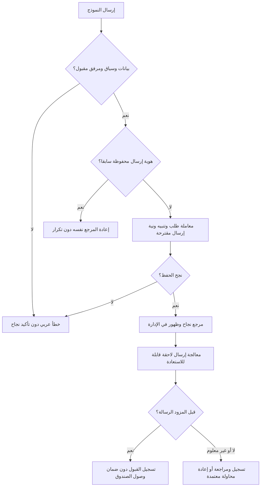
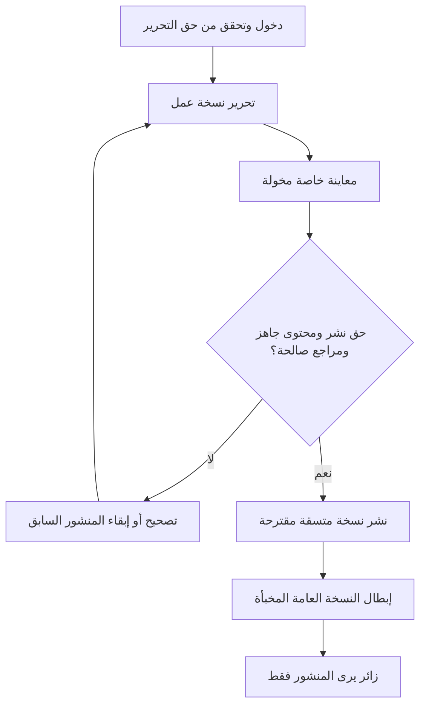

# تدفقات مستخدمي Scenery

المصادر S1 §§6–9،13 وS2 §17، وتعريفها في [مراجعة SRS](SRS_REVIEW.md). هذه 22 مواصفة تدفق للمراجعة، وليست واجهات أو وظائف منفذة. ترتبط رموز الصفحات بـ[الخريطة](SITEMAP.md) والحقوق بـ[الوحدات](MODULE_ANALYSIS.md). كل تحقق اختبار مستقبلي في [المصفوفة](REQUIREMENTS_MATRIX.md).

## F01 تصفح المنتجات

- **المستخدم:** زائر.
- **الشروط المسبقة:** تصنيفات ومنتجات منشورة؛ CAT-001 وPROD-001 وBR-06.
- **نقطة البداية:** P01 أو P02.
- **الخطوات الرئيسية:** يفتح المنتجات؛ يختار تصنيفًا؛ يرى البطاقات بمعلوماتها الفعلية وسعرها وفق وضع كل منتج؛ يتنقل بين النتائج ويفتح P03.
- **البدائل:** تصنيف بلا منتجات يعرض حالة فراغ ومدخلًا واضحًا لبقية الأقسام أو التصنيع.
- **الأخطاء المحتملة:** رابط تصنيف ألغي أو عنصر أخفي أثناء التصفح؛ لا يعرض مخفيًا أو رسالة خطأ تقنية.
- **النتيجة المتوقعة:** وصول الزائر إلى منتج منشور دون تمرير أفقي أو تسرب بيانات سعر مخفي؛ AT-01/02/09.

## F02 البحث عن منتج والتصفية

- **المستخدم:** زائر.
- **الشروط المسبقة:** **مشروط باعتماد PROD-005 عبر Q-B05**؛ حقول البحث والفلاتر وحجم النتائج معتمدة.
- **نقطة البداية:** P02 أو حالة P11.
- **الخطوات الرئيسية:** يدخل عبارة؛ يطبق معيارًا معتمدًا؛ يعرض النظام النتائج المنشورة فقط؛ يستطيع إزالة المعيار وفتح P03.
- **البدائل:** لا نتائج؛ عبارة فارغة؛ العودة إلى عرض التصنيف. البحث بالعربية يختبر بالتشكيل والهمزات وفق القرار لا افتراض محرك خاص.
- **الأخطاء المحتملة:** مدخل ضار أو طلب متكرر أو فشل الشبكة؛ يبقى مسار التصفح الأساسي متاحًا.
- **النتيجة المتوقعة:** نتائج ملائمة وحالة واضحة أو استبعاد الميزة من الإصدار إن لم تعتمد؛ لا يجعل تحليل التدفق البحث مؤكدًا.

## F03 مشاهدة تفاصيل المنتج

- **المستخدم:** زائر.
- **الشروط المسبقة:** منتج منشور ووسائط جاهزة؛ PROD-002/003.
- **نقطة البداية:** بطاقة P02/P11 أو رابط منتج مباشر.
- **الخطوات الرئيسية:** يفتح P03؛ يرى صورًا ومواصفات أُدخلت فعلًا؛ يراجع المقاسات بوحداتها والخامات والخيارات؛ يرى وضع السعر الصحيح؛ يختار الاستفسار أو واتساب.
- **البدائل:** معلومات اختيارية غير مدخلة لا تظهر كخانات فارغة؛ صورة فاشلة تعالج دون حجب النص.
- **الأخطاء المحتملة:** منتج أخفي أو رابط غير موجود؛ لا تسرب لمسودة من رابط مباشر أو بيانات مشاركة.
- **النتيجة المتوقعة:** فهم المنتج والوصول لتواصل صحيح؛ AT-01/02.

## F04 طلب عرض سعر لمنتج

- **المستخدم:** زائر.
- **الشروط المسبقة:** نموذج تواصل معتمد وخصوصية متاحة؛ PROD-004 وCNT-002–005؛ عرض السعر وضع مستقل وليس Checkout.
- **نقطة البداية:** P03.
- **الخطوات الرئيسية:** يختار الاستفسار/عرض السعر؛ يظهر سياق المنتج الموثق؛ يدخل بياناته واحتياجه؛ يوافق وفق السياسة؛ يتحقق الخادم ويحفظ؛ يعود مرجع نجاح بعد الحفظ؛ يدخل F18.
- **البدائل:** المنتج ذو السعر الظاهر قد يستقبل استفسارًا أيضًا؛ لا يكشف النموذج سعر منتج مخفي.
- **الأخطاء المحتملة:** تزوير مرجع المنتج، نقص بيانات، انتهاء النموذج أو فشل حفظ؛ رسالة واضحة دون نجاح كاذب.
- **النتيجة المتوقعة:** سجل واحد مرتبط بمنتج صحيح يظهر للمخول؛ لا التزام بيع أو مبلغ محصل؛ AT-05/12.

## F05 إرسال طلب تصنيع مخصص

- **المستخدم:** زائر داخل مصر أو خارجها.
- **الشروط المسبقة:** Q-B07 لحقول التواصل والوحدات، ونص الخصوصية؛ **المرفقات تنتظر Q-B06 وCUSTOM-002**.
- **نقطة البداية:** P04.
- **الخطوات الرئيسية:** يصف نوع القطعة والمقاسات وخياراته إن عرفت؛ يضيف تواصله والدولة عند الحاجة؛ يرفق صورة فقط إن اعتمدت؛ يقرأ تنويه الاستفسار؛ يرسل؛ تحفظ البيانات والمرفقات المقبولة ويعرض المرجع.
- **البدائل:** عدم معرفة خامة أو لون لا يؤدي لاختراعها؛ يحدد إلزام المقاسات وغيرها من Q-B07. إرسال بلا مرفق حسب السياسة المعتمدة.
- **الأخطاء المحتملة:** نوع/حجم ملف مرفوض، فشل رفع أو حفظ؛ لا يعلن نجاح مرفق لم يحفظ، وتتاح إعادة المحاولة الآمنة.
- **النتيجة المتوقعة:** طلب خاص قابل للمتابعة، وليس أمر شراء؛ AT-06 مشروط جزئيًا بالمرفقات.

## F06 مشاهدة المشاريع

- **المستخدم:** زائر.
- **الشروط المسبقة:** مشاريع منشورة وأغلفة مأذون بها؛ PRJ-001/003 وBR-08.
- **نقطة البداية:** P01 أو P05.
- **الخطوات الرئيسية:** يفتح المشاريع؛ يراجع عنوان العمل وغلافه؛ ينتقل إلى P06؛ يرى وصف الأثاث والخشب والديكور الذي نفذه المصنع.
- **البدائل:** عرض تصنيف المشاريع إذا اعتمد تنظيمه؛ حالة فراغ دون مشاريع وهمية.
- **الأخطاء المحتملة:** إخفاء مشروع أثناء التصفح أو صورة مفقودة؛ لا تبقى نسخة مخفية في المميز أو نتائج القائمة.
- **النتيجة المتوقعة:** وصف حقيقي لنطاق التنفيذ دون ادعاء تشطيب متكامل؛ AT-03/11.

## F07 تشغيل فيديوهات المشروع

- **المستخدم:** زائر.
- **الشروط المسبقة:** فيديو جاهز بصيغة معتمدة وغلاف وضوابط تشغيل؛ PRJ-002 وQ-B10.
- **نقطة البداية:** معرض P06.
- **الخطوات الرئيسية:** يختار الغلاف؛ يطلب تشغيل الفيديو؛ يستخدم الإيقاف/التقدم/الصوت حسب المشغل؛ يعود لألبوم الصور.
- **البدائل:** صور فقط إن لم يوجد فيديو؛ غلاف ورسالة مناسبة عند تعذر التشغيل؛ تقليل الحركة محترم.
- **الأخطاء المحتملة:** شبكة بطيئة أو صيغة غير مدعومة أو ملف غير جاهز؛ لا تحمل كل المقاطع مقدمًا ولا تحجب الصفحة.
- **النتيجة المتوقعة:** مشاهدة اختيارية على الهاتف والكمبيوتر أو بديل مفيد؛ AT-03/09؛ فيديو المنتج ليس إضافة تلقائية.

## F08 الاستفسار عن مشروع مشابه

- **المستخدم:** زائر.
- **الشروط المسبقة:** مشروع منشور ونموذج سياقي؛ PRJ-004 وCNT-002.
- **نقطة البداية:** P06.
- **الخطوات الرئيسية:** يختار عملًا مشابهًا؛ يدخل وصف الاحتياج ووسيلة التواصل؛ يراجع سياق المشروع والموافقة؛ يحفظ النظام استفسارًا مع مرجع المشروع؛ يتبع F18.
- **البدائل:** إن احتاج تصميمًا مختلفًا يمكن الانتقال إلى P04 دون نسبة مواصفات غير موجودة للمشروع.
- **الأخطاء المحتملة:** مرجع غير صالح أو غير منشور أو بيانات ناقصة؛ لا يثق الخادم بعنوان المشروع الوارد من النموذج.
- **النتيجة المتوقعة:** استفسار صحيح المصدر يظهر في A10؛ لا سعر أو عقد تنفيذ مفترض.

## F09 التواصل عبر واتساب

- **المستخدم:** زائر.
- **الشروط المسبقة:** رقم رسمي تم التحقق منه؛ CNT-001 وBR-09 وQ-L02.
- **نقطة البداية:** P01/P03/P06/P07.
- **الخطوات الرئيسية:** يضغط الرابط؛ يفتح واتساب أو مساره المناسب للجهاز؛ تجهز رسالة ذات اسم ورابط المنتج/المشروع إن وجد؛ يختار الزائر إرسالها داخل واتساب.
- **البدائل:** لا تطبيق مناسب أو تعذر الفتح؛ تظل وسيلة النموذج داخل الموقع ظاهرة.
- **الأخطاء المحتملة:** رقم أو ترميز رسالة خاطئ؛ رابط سياق قديم؛ لا يزعم الموقع أن الرسالة أرسلت بمجرد الضغط.
- **النتيجة المتوقعة:** انتقال تواصل خارجي؛ لا تحفظ محادثة أو تنشأ Inquiry تلقائيًا. قياس نقرة إن اعتمد Q-L10 ليس حفظ محادثة؛ AT-10.

## F10 دخول الإدارة

- **المستخدم:** Owner أو Staff نشط.
- **الشروط المسبقة:** حساب أعد بأمان، ولا تسجيل عام للعملاء؛ ADM-001/002؛ Q-B09.
- **نقطة البداية:** A01.
- **الخطوات الرئيسية:** يدخل بياناته؛ يتحقق الخادم دون كشف تفاصيل الحساب لغيره؛ ينشئ جلسة آمنة؛ يفتح A02 أو شاشة مخولة؛ يستطيع الخروج.
- **البدائل:** استرداد وصول عبر الآلية المعتمدة إن تقررت؛ لا حساب مشترك لتجاوز تعطل حساب مفوض.
- **الأخطاء المحتملة:** بيانات غير صحيحة أو حساب معطل أو محاولات مفرطة؛ رفض ورسالة عامة وحدود أمنية.
- **النتيجة المتوقعة:** جلسة مخولة فقط، ورفض الطلبات المحمية عند انتهاء الجلسة أو تعطيل المستخدم؛ AT-08.

## F11 إضافة منتج

- **المستخدم:** المالك أو مفوض له أفعال الإنشاء والنشر.
- **الشروط المسبقة:** دخول وحقوق منفصلة، وتصنيف ونموذج بيانات؛ CMS-001، CAT-001 وQ-B03/04.
- **نقطة البداية:** A03 ثم A04.
- **الخطوات الرئيسية:** يدخل الاسم والوصف والمواصفات المتاحة؛ يحدد التصنيف؛ يختار وسائط A08؛ يحدد أحد أوضاع السعر؛ يتحقق الحفظ؛ يحفظ غير منشور أو ينشر بحق مستقل.
- **البدائل:** إنشاء مسودة ناقصة لا تظهر للعامة؛ لا يفرض مبلغ عند إخفاء السعر أو طلب عرض سعر وفق السياسة.
- **الأخطاء المحتملة:** تصنيف غير صالح، سعر عرض بلا قيمة، ملف غير جاهز، غياب صلاحية النشر؛ لا نشر جزئي.
- **النتيجة المتوقعة:** منتج مضبوط النشر يعرض في موضعه الصحيح عند النشر فقط؛ AT-01/02.

## F12 تعديل منتج

- **المستخدم:** المالك أو مفوض بالتعديل.
- **الشروط المسبقة:** product.update والتحقق من الكائن، وقاعدة التزامن والنشر Q-B15.
- **نقطة البداية:** A03/A04.
- **الخطوات الرئيسية:** يفتح نسخة المنتج؛ يعدل البيانات أو الصور؛ يراجع المحتوى؛ يحفظ حسب سياسة المسودة/النشر المعتمدة؛ تبطل النسخة العامة المخبأة عند تغيير منشور.
- **البدائل:** إخفاء المنتج يبقي بياناته ومرجع الاستفسار؛ الحذف المنطقي منفصل بحق مستقل.
- **الأخطاء المحتملة:** تعديلان متزامنان أو تصنيف عطل أو وسيط حذف؛ يبلغ التعارض ولا يمسح تعديل الآخر بصمت.
- **النتيجة المتوقعة:** تغييرات متسقة وقابلية رجوع تنظيمية حسب القرار، دون فقد استفسارات أو كشف مسودة؛ CMS-001/003/006.

## F13 تغيير ظهور سعر المنتج

- **المستخدم:** المالك أو مفوض بإدارة السعر.
- **الشروط المسبقة:** PROD-003 وCMS-002 وBR-01، واعتماد العملة وما يشمله السعر Q-B04.
- **نقطة البداية:** A04.
- **الخطوات الرئيسية:** يحدد سعرًا ظاهرًا أو مخفيًا أو عرض سعر؛ يضبط قيمة وعملة عند العرض؛ يحفظ وينشر وفق السياسة؛ تبطل النسخ العامة السابقة.
- **البدائل:** منتجان بوضعين مختلفين؛ وضع عرض السعر يقدم مدخل استفسار ولا يحول السعر إلى صفر.
- **الأخطاء المحتملة:** مبلغ سالب أو مفقود مع العرض، حق غير ممنوح، Cache قديم أو Metadata تتضمن المخفي؛ ترفض الحالة غير السليمة وتفحص كل التمثيلات.
- **النتيجة المتوقعة:** استقلال كل منتج وعدم خروج سعر مخفي للعامة؛ AT-02.

## F14 إنشاء مشروع

- **المستخدم:** المالك أو مفوض بإنشاء/نشر المشاريع.
- **الشروط المسبقة:** CMS-004، PRJ-003 وBR-08؛ مواد مأذونة.
- **نقطة البداية:** A06 ثم A07.
- **الخطوات الرئيسية:** يحدد عنوانًا ووصف الأعمال الفعلية؛ يدخل مكانًا فقط إن أذن؛ يختار الغلاف والصور والفيديوهات الجاهزة ويرتبها؛ يعاين وفق السياسة؛ ينشر بحق النشر.
- **البدائل:** حفظ غير منشور حتى اكتمال التصوير؛ مشروع صور فقط دون فيديو مختلق.
- **الأخطاء المحتملة:** غلاف ناقص أو فيديو قيد المعالجة أو وصف يدعي تشطيبًا كاملًا؛ يمنع النشر غير الصالح ويصحح المحتوى.
- **النتيجة المتوقعة:** صفحة مشروع قابلة للاستعراض مع إمكانية إخفائها دون فقد البيانات؛ AT-03/11.

## F15 رفع الصور والفيديوهات

- **المستخدم:** المالك أو مفوض برفع الوسائط.
- **الشروط المسبقة:** CMS-005/006؛ حدود Q-B10 وصلاحية media.upload؛ هذا رفع الإدارة لا مرفق عميل.
- **نقطة البداية:** A08 أو منتقي وسائط A04/A07/A11.
- **الخطوات الرئيسية:** يختار ملفًا أو دفعة؛ يتحقق الخادم من الصيغ والحجم والعدد؛ يحفظ بأسماء آمنة؛ يسجل معالجة/جاهزية؛ يضيف النص البديل والغلاف؛ يربط ويرتب دون إعادة نسخ الأصل.
- **البدائل:** استخدام ملف موجود؛ سياسة قبول جزئي للدفعة أو رفضها كليًا تعتمد في Q-B10 ويعرض وضع كل ملف.
- **الأخطاء المحتملة:** ملف مزور أو كبير، امتلاء مساحة أو تعطل معالجة؛ لا ينشر ملفًا غير جاهز، ولا يعلن نجاح كل الدفعة خطأ.
- **النتيجة المتوقعة:** وسائط صالحة قابلة لإعادة الاستخدام مع منع حذف المستخدم؛ AT-03/04.

## F16 تعديل الرئيسية

- **المستخدم:** المالك أو مفوض بتحرير الرئيسية؛ النشر حق منفصل.
- **الشروط المسبقة:** HOME-001–004 وCMS-007؛ مراجع منتجات ومشاريع منشورة.
- **نقطة البداية:** A11.
- **الخطوات الرئيسية:** يعدل عنوانًا ووصفًا وأزرارًا وروابط؛ يختار المميز؛ يحفظ نسخة عمل مقترحة؛ يعاين كصاحب حق؛ ينشر نسخة متسقة ثم تبطل العامة المخبأة.
- **البدائل:** يترك التحرير دون نشر فتظل النسخة العامة السابقة؛ يرى مستخدم القراءة نسخة منشورة لا مسودة.
- **الأخطاء المحتملة:** رابط غير موثوق أو عنصر أخفي أو تعديل متزامن أو غياب حق نشر؛ يبقى المنشور السابق سليمًا.
- **النتيجة المتوقعة:** توازن أنشطة المصنع، ومعاينة خاصة لا تفهرس ولا تظهر للزائر؛ AT-04 وQ-B15.

## F17 اختيار صورة أو فيديو للـHero

- **المستخدم:** المالك أو مفوض بالتحرير والنشر حسب الفعل.
- **الشروط المسبقة:** A11 وA08، وسيط جاهز وحدود Q-B10، وبديل فيديو.
- **نقطة البداية:** اختيار نوع Hero داخل A11.
- **الخطوات الرئيسية:** يحدد النوع؛ يختار أصلًا موجودًا أو يرفعه عبر F15؛ للفيديو يحدد غلافًا بديلًا؛ يراجع النص والهواتف وتقليل الحركة؛ يعاين وينشر.
- **البدائل:** الانتقال من فيديو لصورة أو العكس دون فقد النسخة المنشورة حتى اكتمال الجديدة؛ إلغاء الاختيار لا ينشر فراغًا.
- **الأخطاء المحتملة:** فيديو لا يعمل أو غلاف غير جاهز أو تعارض نشر؛ يظهر البديل ولا تحجب الصفحة؛ لا حذف لأصل مستخدم آخرًا.
- **النتيجة المتوقعة:** آخر اختيار منشور يعمل أو يقدم بديلًا مناسبًا؛ AT-04/09.

## F18 استقبال الاستفسار الجديد

- **المستخدم:** الزائر ثم النظام ثم المسؤول المخول.
- **الشروط المسبقة:** نوع نموذج معتمد، مرجع إرسال، سياق موثوق، سياسة خصوصية؛ LEAD-001، CNT-004، BR-03.
- **نقطة البداية:** إرسال نموذج من P03/P04/P06/P07.
- **الخطوات الرئيسية:** يتحقق الطلب ومرفقه إن اعتمد؛ تحفظ معاملة الطلب والتنبيه ونية الإرسال المقترحة؛ يثبت الحفظ؛ يعرض المرجع؛ يظهر في A09؛ يحدث عداد اللوحة بالآلية والمهلة المعتمدتين؛ يبدأ F19 لاحقًا.
- **البدائل:** إعادة نفس الإرسال تعيد مرجعه دون نسخة جديدة؛ تعطل البريد يبقي الطلب ظاهرًا وقابلًا للمتابعة.
- **الأخطاء المحتملة:** فشل DB أو رفع أو انقطاع بين الحفظ والدفع للطابور؛ لا نجاح قبل الحفظ، والمصالحة تستعيد الإرسال المنتظر.
- **النتيجة المتوقعة:** استفسار واحد ثابت وتنبيه قابل للعرض دون إعادة تسجيل دخول؛ AT-05/07/12؛ Q-B11/12/16.

## F19 إرسال إشعار البريد

- **المستخدم:** النظام/عامل خلفي، والمالك مستلمًا.
- **الشروط المسبقة:** طلب محفوظ ونية إرسال دائمة مقترحة؛ إعداد مستلم موثق ومزود وعامل معتمد؛ ALERT-002–004.
- **نقطة البداية:** سجل إرسال منتظر بعد F18.
- **الخطوات الرئيسية:** يلتقط العامل سجلًا مستحقًا؛ يتحقق من اعتماد المستلم الحالي؛ يرسل ملخصًا محدودًا ورابط إدارة محميًا؛ يسجل نتيجة المحاولة؛ يجدد حالة السجل.
- **البدائل:** إخفاق مؤقت يعاد وفق السياسة؛ فشل نهائي أو عامل متوقف يصعّد للمسؤول؛ عنوان ملغى يعلق الإرسال حتى المراجعة.
- **الأخطاء المحتملة:** مزود لا يستجيب أو قبول رسالة ثم انقطاع الرد؛ لا يعد القبول وصولًا إلى Inbox، وتحد سياسة التكرار من الإرسال المكرر مع بقاء الغموض موثقًا.
- **النتيجة المتوقعة:** محاولات قابلة للرصد دون فقد الطلب أو تعطيل النموذج؛ AT-07؛ لا SLA أو مزود مفترض.

## F20 متابعة طلبات العملاء

- **المستخدم:** المالك أو مفوض بقراءة الاستفسارات وتعديل المتابعة.
- **الشروط المسبقة:** LEAD-002/003؛ قاموس الحالات وانتقالاتها Q-B08؛ صلاحية مستقلة للمرفقات.
- **نقطة البداية:** A09 أو تنبيه أو رابط بريد يقود لدخول ثم A10.
- **الخطوات الرئيسية:** يبحث بالاسم/الهاتف أو يفلتر بالوقت والحالة والمصدر؛ يفتح الطلب؛ يراجع التفاصيل؛ يضيف ملاحظة داخلية ويغير حالة معتمدة؛ يتواصل بالوسائل المسموحة خارج الموقع.
- **البدائل:** أمثلة «جديد، جاري التواصل، عرض سعر مرسل، مكتمل، مغلق/ملغي» مقترحات لم تعتمد؛ القراءة لا تغير حالة المتابعة تلقائيًا.
- **الأخطاء المحتملة:** مرجع مفقود أو سحب تفويض أثناء الجلسة أو انتقال غير مسموح؛ يمنع الوصول/التغيير دون كشف بيانات.
- **النتيجة المتوقعة:** متابعة واضحة دون تحويل Inquiry إلى Order أو إنشاء محادثات CRM.

## F21 إنشاء حساب إداري إضافي

- **المستخدم:** Owner؛ قدرة حالية يمكن أن يستخدمها لاحقًا.
- **الشروط المسبقة:** ADM-001/002؛ سياسة تهيئة واسترداد Q-B09.
- **نقطة البداية:** A12.
- **الخطوات الرئيسية:** يدخل هوية مستقلة؛ يحدد الحقوق المعتمدة بأقل امتياز؛ يهيئ وسيلة دخول آمنة؛ يفعّل الحساب؛ يختبر الموظف دخوله ووظائفه المسموحة.
- **البدائل:** حساب غير نشط إلى حين التسليم؛ تعطيل يوقف وصوله؛ لا مشاركة لكلمة مرور Owner.
- **الأخطاء المحتملة:** بريد مكرر أو محاولة مفوض إنشاء مالك/حساب أعلى أو إرسال اعتماد غير آمن؛ رفض وتسجيل حسب السياسة، وسجل موسع فقط عند اعتماد ADM-004.
- **النتيجة المتوقعة:** حساب مستقل قابل للتفعيل والإيقاف دون المساس بالمالك؛ AT-08.

## F22 تعديل صلاحيات المستخدم

- **المستخدم:** Owner في المصفوفة المقترحة، أو مسؤول صريح يعتمد لاحقًا ضمن حدود لا تمس حماية المالك.
- **الشروط المسبقة:** ADM-003 وBR-07، مصفوفة Q-B09؛ A12/A13.
- **نقطة البداية:** حساب الموظف وحقوقه.
- **الخطوات الرئيسية:** يراجع الحقوق الحالية؛ يضيف/يسحب أفعالًا محددة؛ يتحقق الخادم من حق التغيير وحماية Owner؛ يحفظ؛ يبطل حقوقًا مخبأة؛ يفحص أثرها على جلسة الموظف القائمة.
- **البدائل:** إيقاف الحساب بالكامل؛ إزالة حق تنزيل دون إزالة قراءة عامة إذا أقرت السياسة فصلها.
- **الأخطاء المحتملة:** تصعيد ذاتي أو تعطيل المالك أو وصول بمرفق/رابط مباشر بعد السحب؛ يمنع بالخادم، لا بمجرد إخفاء زر.
- **النتيجة المتوقعة:** حقوق فعلية متسقة فور سريان التغيير وفق السياسة؛ AT-08. AuditLog تفصيلي مشروط بـADM-004.

## الرسم المشترك لحفظ الاستفسار

المعاملة وسجل نية الإرسال آلية **موصى بها** لسلامة الطلب؛ المطلب المؤكد هو الحفظ قبل إخطار المالك وعدم فقده عند فشل البريد.

## الرسم المشترك لتحرير الرئيسية

## حدود القبول

البحث F02 ومرفقات F05 وقاموس F20 وسجل المراجعة لا تعتمد تلقائيًا. لا تنفذ هذه التدفقات أو تختبر على بيانات عميل أثناء التحليل. أي حد رفع أو زمن أو شاشة مستقلة أو دور جديد يرجع إلى [سجل القرارات](OPEN_QUESTIONS.md) و[الخطة](PROJECT_ROADMAP.md)، ثم إذن صريح للمرحلة التالية.
